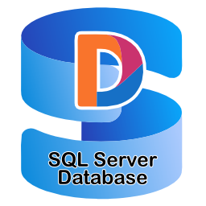



# Rop.Database11

Suite of .NET 11 libraries for advanced database operations with Dapper, including change tracking, caching, and DTO-oriented repository patterns.

## Projects in this Solution

### Rop.Dapper.ContribEx11 (external NuGet dependency)
[](https://www.nuget.org/packages/Rop.Dapper.ContribEx11)
[](LICENSE)

Advanced extensions for Dapper and Dapper.Contrib: slim queries, partial keys, JOIN mapping and full async/await support. Consumed as a NuGet package; it lives in its own repository: [ramoneeza/Rop.Dapper.ContribEx11](https://github.com/ramoneeza/Rop.Dapper.ContribEx11).

### Rop.AbsDatabase11
[](https://www.nuget.org/packages/Rop.AbsDatabase11)
[](LICENSE)

Abstract database layer providing base functionality for database operations.

**Features:**
- Unit of Work pattern implementation
- Transaction management
- Connection pooling
- Result-oriented error handling with `Rop.Results9`

### Rop.SqlDatabase11
[](https://www.nuget.org/packages/Rop.SqlDatabase11)
[](LICENSE)

SQL Server specific implementation with DTO-oriented repository patterns.

**Features:**
- SQL Server Change Tracking integration for reactive updates
- DTO-oriented repository base classes with direct mapping
- Event-driven architecture (OnRecordsChanged events)
- Time-based cache with configurable expiration (default 5 minutes)
- Automatic cache invalidation on external data changes (dual strategy: time + events)
- Type handlers for DateOnly and TimeOnly (.NET 6+)
- Foreign database support
- Multiple repository types (Standard, DTO, Simple, Cached, Partial Key)

[Full Documentation](Rop.SqlDatabase11/Readme.md)

## Quick Start

### Installation

```bash
# Install Dapper extensions
dotnet add package Rop.Dapper.ContribEx11

# Or use internal packages
dotnet add reference ../Rop.SqlDatabase11/Rop.SqlDatabase11.csproj
```

### Basic Usage with Dapper Extensions

```csharp
using Rop.Dapper.ContribEx11;
using Rop.Database11;

// Create database instance
var database = new Database(connectionString);

// Use Dapper extensions directly
var user = connection.GetSlim<User>(userId);
var users = connection.GetAllSlim<User>();
```

### Repository Pattern with DTO Mapping

```csharp
using Rop.Database11;
using Rop.Database11.Repository;

// Entity (your business model)
public class User
{
    public int Id { get; set; }
    public string Name { get; set; }
    public string Email { get; set; }
}

// DTO (database table with Dapper attributes)
[Table("Users")]
public class UserDto
{
    [ExplicitKey]
    public int Id { get; set; }
    public string Name { get; set; }
    public string Email { get; set; }
    public byte[] PasswordHash { get; set; }
}

// Repository with DTO mapping
public class UserRepository : AbsSqlDtoIntRepository<User, UserDto>
{
    public UserRepository(Database database) : base(database) { }
    
    // Map DTO to Entity (hide sensitive fields)
    protected override User Map(UserDto dto)
    {
        return new User
        {
            Id = dto.Id,
            Name = dto.Name,
            Email = dto.Email
            // PasswordHash is not exposed
        };
    }
}

// Use repository
var userRepo = new UserRepository(database);
var user = await userRepo.Get(userId);        // Returns User (entity)
var allUsers = await userRepo.GetAll();       // Returns List<User>
```

### Reactive Cache with Change Tracking

```csharp
using Rop.Database11.CacheRepository;

// Cached repository - automatically invalidates on external changes AND time expiration
public class CachedUserRepository : AbsCacheSqlDtoRepositoryK<User, UserDto, int>
{
    public CachedUserRepository(Database database) 
        : base(
            database, 
            useslim: true,                                    // Use optimized queries
            defaultExpirationTime: TimeSpan.FromMinutes(10),  // Expire after 10 minutes
            changespriority: 3)                               // Change tracking priority
    { }
    
    protected override User Map(UserDto dto)
    {
        return new User { Id = dto.Id, Name = dto.Name, Email = dto.Email };
    }
}

// Repository has DUAL invalidation strategy:
var cachedRepo = new CachedUserRepository(database);

// 1. TIME-BASED EXPIRATION (default 5 minutes, configurable)
// First call - hits database and caches
var user = await cachedRepo.Get(userId);

// Within expiration time - returns from cache
var userAgain = await cachedRepo.Get(userId);

// After expiration time - automatically reloads from database
Thread.Sleep(TimeSpan.FromMinutes(10));
var userExpired = await cachedRepo.Get(userId);

// 2. EVENT-BASED INVALIDATION (via Change Tracking)
// When another service updates the Users table:
// - SQL Server Change Tracking detects the change immediately
// - Repository receives notification via event
// - Cache entry is IMMEDIATELY invalidated (regardless of time)
// - Next Get(userId) will fetch fresh data

// This ensures:
// ✅ Fast reads from cache when data hasn't changed
// ✅ Automatic refresh on time expiration
// ✅ Immediate updates when external services modify data
// ✅ No stale data in distributed scenarios
```

## Architecture

```
Rop.Database11/
|
+-- Rop.AbsDatabase11/               # Abstract database layer
|   +-- icon.png                     # Project icon
|   +-- AbsDatabase.cs               # Base database class
|   +-- AbsDatabase.*.cs             # Partial implementations
|
+-- Rop.SqlDatabase11/               # SQL Server implementation
    +-- icon.png                     # Project icon
    +-- Database.cs                  # SQL Server database
    +-- Repository/                  # Repository implementations
    |   +-- AbsSqlRepository.cs      # Standard repositories
    |   +-- AbsSqlDtoRepository.cs   # DTO repositories
    |   +-- AbsSimpleSqlRepositoryK.cs  # Simple repositories
    +-- CacheRepository/             # Cached repository with auto-invalidation
    +-- PartialKeyRepository/        # Composite key repositories
    +-- Tracking/                    # Change tracking
    +-- CycleTask/                   # Task queue for change detection
    +-- TypeHandlers/                # DateOnly/TimeOnly handlers
```

## Requirements

- **.NET 11.0** or higher
- **C# 15**
- **SQL Server** (for Rop.SqlDatabase11)
- **Dapper 2.1.66+**
- **Dapper.Contrib 2.0.78+**

### Enable SQL Server Change Tracking

```sql
-- Enable on database
ALTER DATABASE MyDatabase
SET CHANGE_TRACKING = ON
(CHANGE_RETENTION = 2 DAYS, AUTO_CLEANUP = ON);

-- Enable on table
ALTER TABLE MyTable
ENABLE CHANGE TRACKING
WITH (TRACK_COLUMNS_UPDATED = OFF);
```

## Documentation

- [Rop.Dapper.ContribEx11 Documentation](https://www.nuget.org/packages/Rop.Dapper.ContribEx11) - Dapper extensions and helpers (external package)
- [Rop.AbsDatabase11 Documentation](Rop.AbsDatabase11/Readme.md) - Abstract database layer and Unit of Work
- [Rop.SqlDatabase11 Documentation](Rop.SqlDatabase11/Readme.md) - Repository patterns and Change Tracking

## Testing

```bash
dotnet test
```

## Contributing

Contributions are welcome! Please:

1. Fork the repository
2. Create a feature branch (`git checkout -b feature/amazing-feature`)
3. Commit your changes (`git commit -m 'Add amazing feature'`)
4. Push to the branch (`git push origin feature/amazing-feature`)
5. Open a Pull Request

## License

This entire solution is licensed under **GPL-3.0-or-later**.

All projects in this repository:
- **Rop.AbsDatabase11**
- **Rop.SqlDatabase11**

are distributed under the [GNU General Public License v3.0 or later](https://www.gnu.org/licenses/gpl-3.0.html).

See [LICENSE](LICENSE) file for full license text.

### What this means:

- ✅ You can use this software freely
- ✅ You can modify the source code
- ✅ You can distribute modified versions
- ⚠️ Any modifications must also be GPL-3.0-or-later
- ⚠️ You must disclose the source code of derivative works
- ⚠️ You must include copyright and license notices

## Contact

**Ramon Ordiales Plaza**
- GitHub: [@ramoneeza](https://github.com/ramoneeza)

## Acknowledgments

- [Dapper](https://github.com/DapperLib/Dapper) - Micro-ORM for .NET
- [Dapper.Contrib](https://github.com/DapperLib/Dapper.Contrib) - CRUD helpers

## Roadmap

- [x] Basic Dapper extensions
- [x] Repository pattern with DTO support
- [x] Change tracking integration
- [x] Cached repositories with auto-invalidation
- [x] Event-driven architecture
- [ ] Multi-database support (PostgreSQL, MySQL, SQLite)
- [ ] Performance benchmarks
- [ ] Horizontal scaling support

---

**Made with ❤️ by Ramon Ordiales Plaza**

*Copyright © 2025 - All rights reserved*
